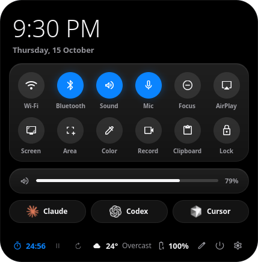

# Lost Island for Archcraft Sway

A compact, black dynamic island for Sway, maintained by [byte4day](https://github.com/byte4day). This is a customized Linux build of [Marco Zorn's Lost Island v1.7.2](https://github.com/MarcoZorn/lost-island/tree/v1.7.2), with its MIT license and original attribution preserved. It is designed for Archcraft, and should also work on Arch Linux with Sway and GTK4 layer shell.




The design follows Apple's Live Activity guidelines for the Dynamic Island: a 37 px black capsule with a thin outline, a leading graphic and a trailing status on either side of an empty middle, a separate circle for a second activity, and inner corners that follow the outer curve. Every change of shape is a spring animation. Set **Shape** to **Notch** in settings for a MacBook-style notch that hangs from the top edge.

The idle pill shows the Arch mark and the clock. While music plays it shows the album art, the title, and EQ bars in the album's color. Click the pill to open the card, or press <kbd>Super</kbd>+<kbd>I</kbd> with the binding below.

[Watch the 11-second demo](media/demo.mp4) (recorded before this redesign): the pill opens into the card, playback pauses and resumes, and the card closes.

## Live activities

Several things can be live at once. The most important one fills the pill and the next one gets the round bubble beside it:

1. **Screen recording**: a pulsing red dot and the elapsed time.
2. **Claude Code needs you**: the Claude spark and, in orange, what it is asking (for example "Allow Bash?").
3. **Music**: album art, title and EQ bars.
4. **Claude Code working**: the spinning spark and what it is doing ("Run tests", "Edit app.py"); **Done** shows for 8 seconds when it finishes.
5. **Downloads and copies**: a ring and the percentage or size received.
6. **Focus timer**: a progress ring and the time left. A round ends with a chime and a peek.

Click the Claude activity to bring its terminal to the front. Click the bubble for music to switch to the player, or for the timer to pause it.

**Claude Code status** needs its hooks once: `PYTHONPATH="$HOME/.local/share/lost-island" python3 -m lostisland --setup-claude-status`. It copies a small hook to `~/.config/lost-island/`, backs up `~/.claude/settings.json`, and adds the hook to the session events without touching your other hooks. New Claude Code sessions then report their status. `--remove-claude-status` takes the hooks out again.

**Downloads** from Firefox and Chromium in `~/Downloads` show up by themselves. For scripts, pipe their output through `bin/island-progress`:

```sh
rsync -a --info=progress2 src/ dst/ | ~/.local/share/lost-island/bin/island-progress "Backing up"
pv -n big.iso 2>&1 >/mnt/usb/big.iso | ~/.local/share/lost-island/bin/island-progress "Copying ISO"
```

## Notifications

A notification opens the island into a banner with the app's icon, the title, two lines of text and the notification's own buttons (for example **Reply** or **Mark as read**). Click the banner to open the app, a button to run that action, or × to dismiss it. The banner stays while the pointer is over it. Buttons act on mako's copy of the notification, so they work exactly like clicking it in mako. Focus (Do Not Disturb) hides banners. The volume and brightness popups from Archcraft's scripts are skipped, because the island draws its own.

Volume, brightness and Caps Lock changes, and plugging in the charger, show as short peeks.

## What the card does

- **Music.** Cover, title, artist, seek bar and large play, previous and next buttons. The player takes its color from the album art, and a small badge shows the playing app (Spotify, Firefox and so on). Without a cover, the tile shows the app's logo. When a player publishes no track length (common for browser players), the seek bar is hidden instead of showing `0:00`.
- **Controls.** A grid of round buttons: Wi-Fi, Bluetooth, sound and mic switches; Focus (Do Not Disturb); AirPlay; Screen and Area screenshots; Color picker; Record; Clipboard; Lock. Blue means on. Right-click a switch to open its settings app. Wi-Fi and Bluetooth show the connected network or device name under the button.
- **Edit the controls.** Click the pencil in the info line, or press and hold any control. The controls jiggle: drag one onto another to move it, click − to remove it, and click + on a control in the tray below to add it back (Power, Timer and Settings start in the tray). Launchers can be removed and added the same way. Click ✓ when done. The layout is saved in `config.json` as `controls` and `launchers`.
- **Volume.** A full-width slider that shows the current level as soon as the card opens.
- **Launchers.** Claude Code, Codex and Cursor Agent CLIs open in Alacritty.
- **Info line.** Focus timer (scroll over it to set 5 to 90 minutes), weather, battery, then Edit, Power and Settings. A CPU or memory warning appears under it only when usage is high.

### Shortcuts on the pill

- Scroll over the pill to change volume by 5%.
- Middle-click the pill to play or pause.
- Right-click opens or closes the card. A horizontal swipe changes the pill face.
- With a Claude activity in the pill, a click brings that terminal to the front.

To open the card from the keyboard, add this to your Sway config:

```sh
bindsym $mod+i exec env PYTHONPATH=$HOME/.local/share/lost-island python3 -m lostisland --toggle
```

`python3 -m lostisland --timer` starts or pauses the focus timer, if you want a key for that too.

### Tools

- **Screen** captures the focused display and **Area** lets you drag a region (Esc cancels). Both save a PNG to `~/Pictures/Screenshots/` and copy it to the clipboard. The card closes first, so it is not in the picture.
- **Color** picks a pixel with `hyprpicker` and copies its hex code. The pill briefly shows a swatch.
- **Focus** switches mako's `do-not-disturb` mode. It hides notifications and stops the island from showing notification peeks. Add the mode to your mako config (see Requirements).
- **Power** opens Lock, Log out, Sleep, Restart and Shut down. Every action except Lock needs a second click within 4 seconds. Lock runs `~/.config/sway/scripts/current_lock` when it exists, otherwise `swaylock -f`.
- **Clipboard** lists the last 25 pieces of text you copied. Click one to copy it again; **Clear** empties the list. History is kept in memory only and is never written to disk, so copied passwords do not end up in a file. It is empty again after the island restarts.

**Screen recording:** Click **Record** to choose a display when more than one is connected, then choose **With audio** or **Without audio**. With audio captures the default output's system sound, not the microphone. Stop finalizes an MP4 in `~/Videos/Recordings/`. A recording indicator and timer remain visible on the pill.

## Requirements

- Sway on Wayland, Python 3.11 or newer, GTK4, libadwaita, PyGObject and GTK4 layer shell.
- Arch/Archcraft packages for the core interface and controls: `python`, `python-gobject`, `python-cairo`, `gtk4`, `gtk4-layer-shell`, `libadwaita`, `libpulse`, `networkmanager`, `bluez`, `bluez-utils`, `util-linux`, and `ttf-material-symbols-variable` (Archcraft also provides this font through `archcraft-fonts`).
- `wf-recorder` for screen recording; `pactl` from `libpulse` and a working PulseAudio/PipeWire output for system audio.
- [UxPlay](https://github.com/FDH2/UxPlay) for the AirPlay button. It needs Avahi/mDNS and GStreamer plugins for video and audio; the button reports when the executable is missing.
- `grim`, `slurp`, `wl-clipboard` and `hyprpicker` for the screenshot, clipboard and color tools; `mako` for Focus.
- Optional: `upower` for battery, `cava` for live EQ, `alacritty` for the CLI launchers, and the `claude`, `codex`, and `cursor-agent` commands for their respective buttons. Music requires an MPRIS-capable player.

On Arch Linux, install the repository packages with:

```sh
sudo pacman -S --needed python python-gobject python-cairo gtk4 gtk4-layer-shell libadwaita libpulse networkmanager bluez bluez-utils util-linux ttf-material-symbols-variable wf-recorder upower cava alacritty avahi gstreamer gst-plugins-base-libs gst-plugins-good gst-plugins-bad gst-libav grim slurp wl-clipboard hyprpicker mako playerctl
```

For the Focus button, add this section to the end of your mako config, then run `makoctl reload`:

```ini
[mode=do-not-disturb]
invisible=1
on-notify=none
```

Media keys should control the same players as the island. Archcraft's Sway config sends them to `mpc` (MPD only), so browser and Spotify playback ignores them. Point them at `playerctl` instead:

```sh
bindsym XF86AudioPlay  exec playerctl play-pause
bindsym XF86AudioPause exec playerctl play-pause
bindsym XF86AudioNext  exec playerctl next
bindsym XF86AudioPrev  exec playerctl previous
bindsym XF86AudioStop  exec playerctl stop
```

NetworkManager, Bluetooth, and an audio server must already be configured for their controls to work. Installing the packages alone does not configure those system services.

UxPlay is available as the `uxplay` AUR package (`yay -S uxplay`), or can be [built from the official v1.73.7 source](https://github.com/FDH2/UxPlay/tree/v1.73.7) into `~/.local/bin`. This build was tested with UxPlay 1.73.7. Ensure `avahi-daemon` is running and the sending device is on the same network. Click **AirPlay** to advertise the receiver as **Lost Island**; click **AirPlay on** to stop it. The receiver starts only when requested and stops when the island quits. On Sway, the app uses UxPlay's `waylandsink`, disables timestamp synchronization (`-vsync no`), forces software H.264 decoding (`-avdec`), and disables its sRGB conversion (`-srgb no`). These settings produced a clear live iPhone mirror on the original Archcraft machine after the default settings showed severe horizontal corruption. Audio uses UxPlay's default sink. UxPlay's [upstream README](https://github.com/FDH2/UxPlay/blob/v1.73.7/README.md) covers these options, network ports, plugins, and optional `~/.uxplayrc` settings.

## Install on Sway

This project runs from a user-owned checkout; it does not need `sudo pip`, an AUR build, or the upstream `lost-island` package. The service template assumes this checkout path:

```sh
git clone https://github.com/byte4day/lost-island-archcraft-sway.git "$HOME/.local/share/lost-island"
mkdir -p "$HOME/.config/systemd/user"
cp "$HOME/.local/share/lost-island/packaging/lost-island.service" "$HOME/.config/systemd/user/lost-island.service"
systemctl --user daemon-reload
systemctl --user enable --now lost-island.service
```

If you already have `~/.local/share/lost-island` or a user `lost-island.service`, back it up before cloning or copying the unit. If the upstream service is already running, restart it after installing this user unit: `systemctl --user restart lost-island.service`.

For Sway sessions that do not start `graphical-session.target`, add **one** startup command to your existing Sway startup file or config:

```sh
systemctl --user import-environment WAYLAND_DISPLAY XDG_CURRENT_DESKTOP
systemctl --user start lost-island.service
```

In a Sway config, use `exec sh -c 'systemctl --user import-environment WAYLAND_DISPLAY XDG_CURRENT_DESKTOP; systemctl --user start lost-island.service'`. In Archcraft's executable startup script, add the two commands after its other session setup. Do not add both methods. To replace an existing bar, back up its Sway config and remove or comment only that bar's startup command; do not stop network, tray, notification, or policy services just because they appeared beside the bar.

Open the card by clicking the pill. The gear at the end of the info line opens settings. By default the island keeps a 47 px strip at the top of its monitor free, so windows start below it and their title bars are never covered; turn off **Keep windows below the island** to let windows reach the top edge. Settings are saved at `~/.config/lost-island/config.json`, which is created on first run; this file is intentionally absent from the repository. Change the island monitor, clock, modules, faces, and accent there or through the settings window. Each card feature (tools, clipboard, quick toggles, weather and so on) can be turned off under Modules. The default theme is pure black with a blue (`#0A84FF`) accent for switches that are on. The automatic pill face returns to the clock when playback pauses.

## Use and checks

```sh
systemctl --user status lost-island.service
journalctl --user -u lost-island.service -n 50 --no-pager
avahi-browse -rt _airplay._tcp  # after turning AirPlay on in the island
PYTHONPATH="$HOME/.local/share/lost-island" python3 -m unittest discover -s "$HOME/.local/share/lost-island/tests" -v
```

The Claude, Codex, and Cursor buttons open their **installed terminal CLIs** through Alacritty. They do not install or sign in to those products. If a button says its command is missing, install that CLI through its official instructions and ensure its executable is on `PATH` or in `~/.local/bin`. This build uses `~/.config/sway/alacritty/alacritty.toml` when present and Alacritty's default configuration otherwise.

The recording picker lists connected display connectors from GTK. If you select **With audio** and the default output monitor disappears before recording starts, the recorder reports an error instead of silently saving a mute file. A short video-only test and a short video-plus-system-audio test were completed on the original Archcraft/Sway setup. `wf-recorder` usage is documented [upstream](https://github.com/ammen99/wf-recorder/blob/master/README.md).

## Prompt for an AI setup agent

Copy this prompt into a coding agent that has access to the target user's machine. It is written for an Archcraft or Arch Linux Sway session:

```text
Set up https://github.com/byte4day/lost-island-archcraft-sway for me as my Sway dynamic island. Read the repository README and inspect my current Sway configuration, startup files, user systemd units, existing bar, available monitors, audio service, package manager, and installed CLI tools before editing anything. Preserve my settings and back up any service or Sway files you change.

Install the documented Arch packages if missing, including UxPlay 1.73.7 or a compatible release and its Avahi/GStreamer dependencies. Clone the repository to ~/.local/share/lost-island (or update an existing checkout safely). Install the provided user systemd unit and ensure the Sway session starts it exactly once with WAYLAND_DISPLAY available. If I have an existing bar, replace only that bar's startup entry after checking what other services it launches; keep network, Bluetooth, tray, notifications, and policy services working. Set the island to the monitor I use and keep the black minimal theme. Do not copy another machine's config.json or credentials.

Verify the Arch pill, expanded controls, MPRIS music behavior, both display choices when I have multiple screens, and the recording setup's audio choices. Test that stopping a short recording produces a playable MP4, and remove that test file afterward. Check that the AirPlay button starts and stops UxPlay and advertises Lost Island through Avahi; report if no AirPlay sender is available to test an actual stream. Check the Claude, Codex, and Cursor Agent buttons only against CLIs already installed for me; do not install or authenticate those services without asking. Run the repository tests and inspect systemd status and logs. Explain the files you changed, how to undo the setup, and any feature that could not be verified on my machine.
```

## Remove or revert

Stop and disable the user service with `systemctl --user disable --now lost-island.service`. Remove the Sway startup line you added, then restore your backed-up service and bar configuration if desired. Your settings are in `~/.config/lost-island/`, recordings are in `~/Videos/Recordings/`, screenshots are in `~/Pictures/Screenshots/`, and the checkout is in `~/.local/share/lost-island/`; remove these only if you no longer need their contents.

## Credits and license

The application started from [Lost Island](https://github.com/MarcoZorn/lost-island) by Marco Zorn, licensed under MIT; this repository retains the original copyright notice. The Arch mark is adapted from the installed Papirus icon theme. Claude, Codex, and Cursor artwork remains the property of its respective owners and is used only to identify the corresponding launcher. This project is an independent customization, not an official Apple, Anthropic, OpenAI, Cursor, or Archcraft product. See [LICENSE](LICENSE).
